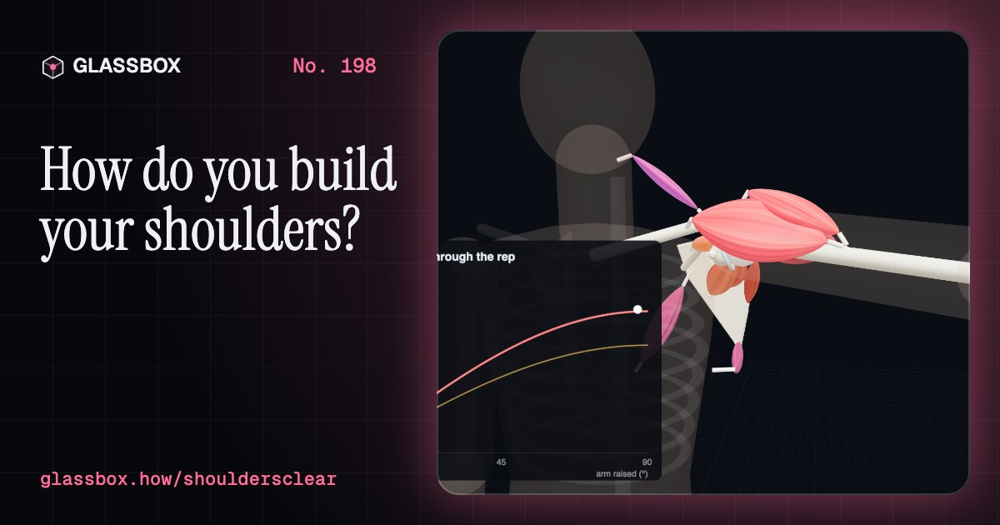
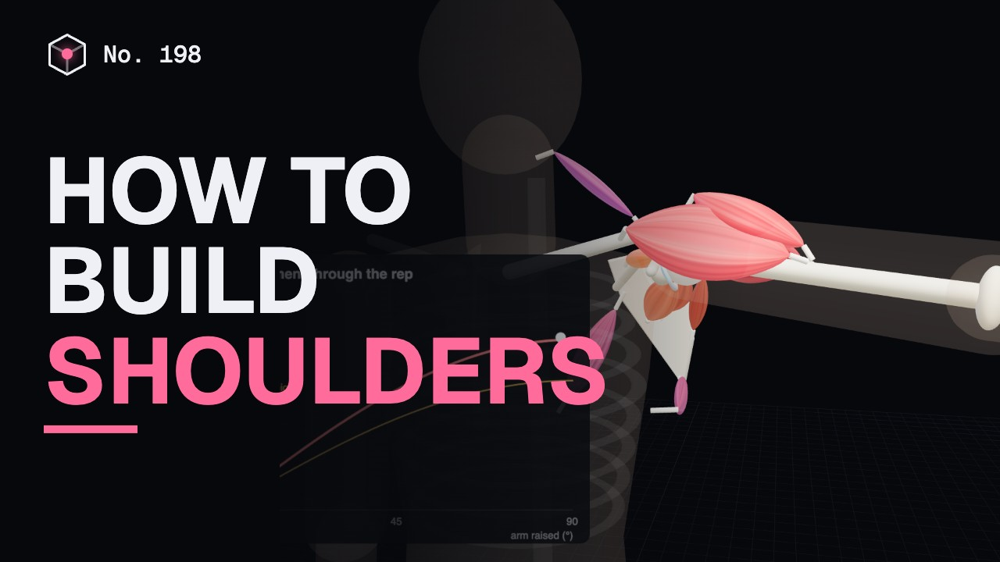
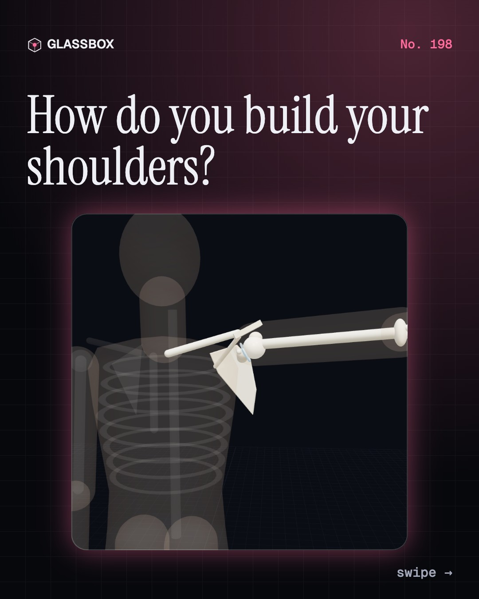
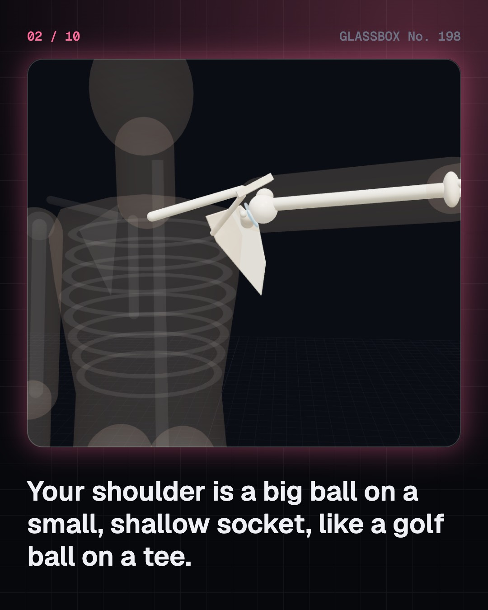
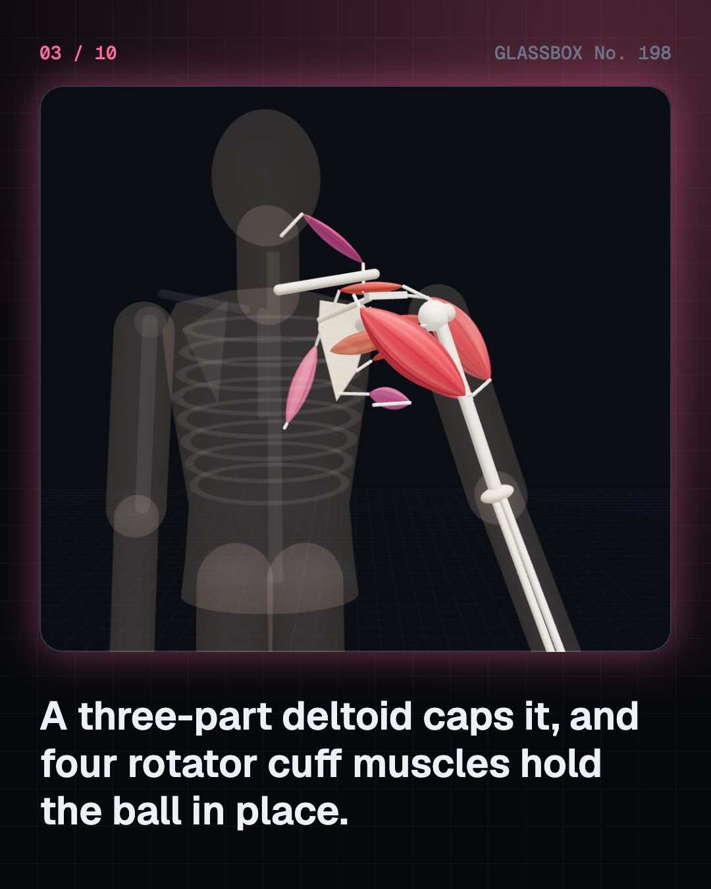
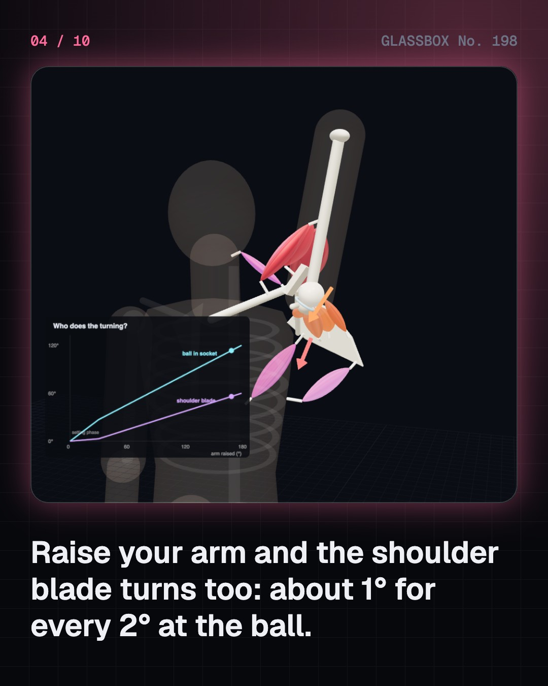

<!-- glassbox:start -->
<!-- Generated from glassbox.json by the Glassbox hub (npm run readme -- shouldersclear). Edit glassbox.json, not this block. -->
<p align="center"><a href="https://glassbox.how/e/shouldersclear/"></a></p>

<h1 align="center">ShouldersClear</h1>

<p align="center"><b>How do you build your shoulders?</b><br>The shoulder is a golf ball on a tee: the most mobile joint you have, held on mostly by muscle. Raise an arm and watch the blade turn with it, work out why a 5 kg dumbbell feels heavy out to the side, swing a gada, and learn to train it safely.</p>

<p align="center"><a href="https://glassbox.how/shouldersclear/"><b>▶ Play with it</b></a> &nbsp;·&nbsp; <a href="https://glassbox.how/e/shouldersclear/">Read the 60-second explainer</a></p>

<p align="center">
  <a href="https://glassbox.how/e/shouldersclear/"></a>
  <a href="https://glassbox.how/e/shouldersclear/"></a>
  <a href="LICENSE"></a>
  <a href="LICENSE-CONTENT.md"></a>
  <a href="#privacy"></a>
</p>

## In 60 seconds

1. **A golf ball on a tee.** Three bones meet at the shoulder: the collarbone, the shoulder blade and the humerus. The humerus's big ball sits on the glenoid, a small, shallow socket. A three-part deltoid caps it, and four rotator cuff muscles wrap the ball.
2. **The ball and the blade share every raise.** Lift your arm 180° and roughly 120° happens at the ball and 60° comes from the shoulder blade turning on your ribs: the 2:1 scapulohumeral rhythm measured in 1944. The cuff pulls the ball into the socket so the deltoid can turn it instead of sliding it up.
3. **Leverage makes light weights heavy.** In a lateral raise a 5 kg dumbbell 63 cm out twists the shoulder with about 31 N·m, plus 10 N·m from your own arm, peaking at 90°. The side deltoid pulls only about 3 cm from the joint, so it works with forces of a thousand newtons. A gada's long handle adds a lever of its own.
4. **Hard sets, patience and balance.** Muscle grows from tension and sets taken close to failure, about 10 or more a week per muscle, with light or heavy loads. Strength comes first, size over weeks to months. Pair pressing with pulling, eat about 0.8 g of protein per kg a day from food (ICMR-NIN), and skip the powders.
5. **Train without pain.** Most shoulder pain settles with exercise; surgery to shave the acromion did no better than placebo in the 2018 CSAW trial. A dislocation needs A&E, and a frozen shoulder a doctor. Steroids are harmful and banned (WADA and NADA).
6. **From akhara to clinic.** Indian wrestlers swung the gada and jodi for centuries, and British soldiers took the clubs home in the 1800s as Indian clubs. Medicine took until the 20th century to measure the rhythm and learn that progressive exercise is the first treatment.

## Words worth knowing

| Term | Meaning |
|---|---|
| **Deltoid** | The shoulder's cap muscle, with front, side and rear parts that raise the arm. |
| **Rotator cuff** | Supraspinatus, infraspinatus, teres minor and subscapularis: four muscles that turn the arm and keep the ball centred. |
| **Glenoid** | The shallow socket on the shoulder blade that the ball of the humerus sits in. |
| **Scapulohumeral rhythm** | About 2° of movement at the ball for every 1° the shoulder blade turns, over a full raise. |
| **Moment (torque)** | Turning effect: force × horizontal distance from the joint, in newton-metres. |
| **Hard set** | A set taken close to failure, with only a few reps left in reserve. |
| **Impingement** | The cuff tendon and bursa being squeezed under the acromion as the arm lifts. |
| **Gada and jodi** | The Indian mace and pair of wooden clubs swung in akharas to build strong shoulders. |

## A short history

**From the Arthashastra's clubs and Hanuman's gada to Indian clubs in London, the 2:1 rhythm and a surgery that failed its placebo test.**

- **300 BCE** · Clubs in the Arthashastra (Kautilya (attributed), Pataliputra (traditionally))
- **1135** · The Manasollasa describes pole and club drills (King Someshvara III of the Western Chalukyas, Kalyani, Karnataka)
- **1834** · The first English book on club swinging (Donald Walker, London)
- **1910** · Gama wins the John Bull Belt (Ghulam Mohammad Baksh, the Great Gama, London)
- **1934** · Codman's book The Shoulder (Ernest Amory Codman, Boston)
- **1944** · The 2:1 rhythm is measured (Verne Inman, J. B. de C. M. Saunders and LeRoy Abbott, San Francisco)
- **1972** · Neer blames the acromion (Charles S. Neer II, New York)
- **2017** · More sets, more growth (Brad Schoenfeld, Dan Ogborn and James Krieger, New York)

The full story, with 27 moments, charts, people and 24 sources: [glassbox.how/e/shouldersclear/history](https://glassbox.how/e/shouldersclear/history/). The data lives in [`history.json`](history.json).

## Video and slides

Made with the Glassbox studio from this box's storyboard (`window.glassbox.director`). Free to reuse under CC BY 4.0.

<a href="https://glassbox.how/shouldersclear/glassbox/video.mp4"></a>

<p><a href="glassbox/slide-1.jpg"></a> <a href="glassbox/slide-2.jpg"></a> <a href="glassbox/slide-3.jpg"></a> <a href="glassbox/slide-4.jpg"></a></p>

| File | What | Size |
|---|---|---|
| `glassbox/slide-1…10.jpg` | Instagram carousel | 1080×1350 |
| `glassbox/thumb.jpg` | YouTube thumbnail | 1280×720 |
| `glassbox/cover.jpg` | Share card and repo social preview | 1200×630 |
| `glassbox/history-slide-*.jpg` | History carousel | 1080×1350 |
| `glassbox/post.json` | Post copy and schedule used by the publish kit | |

## Privacy

This box has no accounts and no ads, and it ships its own fonts and libraries. When you run it yourself it sends nothing anywhere. On glassbox.how, the site's `/bar.js` also loads Glassbox's analytics: **Google Analytics** to count visits (it asks first in the EU, UK and Switzerland, and stays off when your browser sends Global Privacy Control or Do Not Track) and **ClickTrust** to detect bots.

It remembers a few things **in your own browser only**, and never sends them anywhere:

| Browser storage key | What it holds |
|---|---|
| `shouldersclear.v1` | Which chapters you have opened, your best quiz scores, and sound on or off. |

Exactly what each one sees is at [glassbox.how/privacy](https://glassbox.how/privacy/).

## Licences

- **Code:** [MIT](LICENSE). Use it, change it, ship it.
- **Explanations, text, images and videos** (`glassbox.json`, `glassbox/`): [CC BY 4.0](LICENSE-CONTENT.md). Credit “Glassbox, glassbox.how/e/shouldersclear”.
- **Third-party parts** keep their own licences: [three.js](https://threejs.org) (MIT), [Geist, Instrument Serif](https://openfontlicense.org) (SIL OFL 1.1).
- The Glassbox name and logo aren't covered by either licence. See the [terms](https://glassbox.how/terms/).

Found a mistake? [Open an issue](https://github.com/bdeeps/shouldersclear/issues). Corrections happen in public.
<!-- glassbox:end -->

## Run it

It's plain HTML, CSS and JavaScript. No build step and no dependencies. Run locally, it contacts no other website.

```bash
python3 -m http.server 8000
```

Three.js and the fonts ship in `vendor/` and `fonts/`, so it also works offline.

Then open http://localhost:8000.

## How it's built

| File | What |
|---|---|
| `index.html`, `css/app.css` | The page and its styles |
| `js/app.js`, `js/stage.js`, `js/ui.js`, `js/kit.js` | The shared Glassbox 3D engine: chapters, 3D stage, controls, quiz, video director |
| `js/chapters/*.js` | One file per chapter: the 3D model, controls, text, key terms, quiz and video scenes |
| `js/shoulder.js` | The rigged shoulder (clavicle, scapula, humerus, deltoid, rotator cuff), the 2:1 scapulohumeral rhythm, segment masses and moment arms, and the gada, club and dumbbell props |
| `glassbox.json` | Title, question, explainer beats, key terms, browser storage and credits shown on glassbox.how |
| `reel` in each chapter | The storyboard the Glassbox studio records into short videos |
| `glassbox/` | The published video, slides, thumbnail and post copy |
| `fonts/`, `vendor/three/` | Self-hosted Geist and Instrument Serif (SIL OFL 1.1) and three.js (MIT) |
